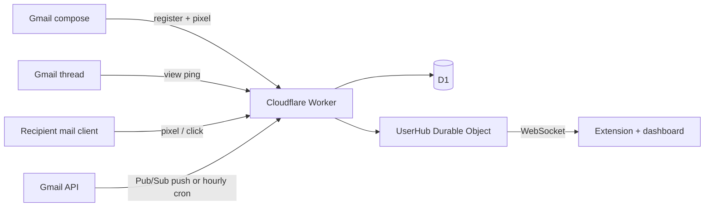

<p align="center">
  
</p>

# Mail Tracker

**WhatsApp-style read receipts for Gmail.** Every email you send gets a tick right inside Gmail — sent, delivered, opened, bounced — plus replies and optional link clicks. Self-hosted on Cloudflare, no third-party tracking service, and you own all of the data.

[](https://github.com/ridh21/mail-tracker/actions/workflows/ci.yml)
[](LICENSE)
[](https://workers.cloudflare.com/)
[](https://developer.chrome.com/docs/extensions/)
[](https://www.typescriptlang.org/)

> **Status:** v0.1 — working end to end and covered by tests, but still early. APIs and schema may change before v1. Issues and PRs are welcome.

## Contents

- [The ticks](#the-ticks)
- [Features](#features)
- [How it works](#how-it-works)
- [Tech stack](#tech-stack)
- [Repository layout](#repository-layout)
- [Self-hosting](#self-hosting)
- [Local development](#local-development)
- [Commands](#commands)
- [Configuration](#configuration)
- [API](#api)
- [Data model](#data-model)
- [Security and privacy](#security-and-privacy)
- [Troubleshooting](#troubleshooting)
- [Known limitations](#known-limitations)
- [Contributing](#contributing)
- [License](#license)

## The ticks

| Tick | State | What it means |
| :---: | --- | --- |
|  | **Sending** | The extension registered the email, but Gmail has not confirmed it yet. |
|  | **Sent** | Gmail confirmed the send and the message was linked to its Gmail id. |
|  | **Delivered** | No bounce arrived within 3 minutes. Email has no real delivery receipt, so this is the same heuristic every tracker uses. |
|  | **Opened** | A human opened it. The count, timeline and ignored-hit log are on the dashboard. |
|  | **Bounced** | A delivery failure was found in the thread. |
|  | **Not tracked** | The email was sent outside Gmail or with tracking switched off. Replies still sync. |

Ticks appear in the Gmail thread list, on each sent message, in the extension popover, and on the self-hosted dashboard. A desktop notification fires when someone opens an email or replies, even if Gmail is closed.

## Features

- **Ticks inside Gmail** — no separate inbox or browser tab required.
- **Realtime opens** — pixel hits go through a per-user Durable Object and arrive over WebSocket in about a second.
- **Replies and bounces** — Gmail API history sync (via Pub/Sub push or an hourly cron) picks up inbound messages and delivery failures.
- **False-open filtering** — your own views, quoted pixels, Apple Mail Privacy Protection, security scanners, repeat fetches, and just-sent hits are filtered out or revoked.
- **Compose-level control** — a toolbar button switches tracking off for one email; Settings switches it off by default.
- **Optional click tracking** — links can be rewritten through HMAC-signed redirects. Off by default because rewritten links can affect deliverability.
- **Dashboard** — Sent list with search and filters, per-message timeline and open log, insights (open rate, reply rate, time to first open, daily opens, hour-of-week heatmap), and session management.
- **Dark mode and a public landing page** — the dashboard ships a theme toggle and a `/welcome` page.
- **Self-hosted and free-tier friendly** — Cloudflare Workers, D1, Durable Objects, Cron, and Workers Assets; Google Cloud and InboxSDK are free for personal use.

## How it works



1. **On send.** The content script adds a 1×1 pixel to the top of the compose body (Gmail clips long messages, so the top matters), optionally rewrites links, and registers the message with the Worker. If the network drops, the extension keeps an outbox and retries for up to three days.
2. **On open.** The recipient's mail client requests `/o/<trackingId>.gif`. The Worker rate-limits the hit, classifies the source, stores a daily-salted IP hash, and forwards the hit to that user's `UserHub` Durable Object. If the message is not registered yet, the raw hit is kept as an orphan and adopted when registration lands.
3. **Classification.** The Durable Object serialises hits per user, decides whether the open counts, writes an `open_events` row to D1, updates the cached counters, and broadcasts a `message` / `open` / `revoke` event over WebSocket.
4. **Replies and bounces.** When Pub/Sub is configured, the Worker calls Gmail `users.watch` for `INBOX` and `SENT` and Pub/Sub pushes changes to `/webhooks/gmail`. Without Pub/Sub, the hourly cron syncs recent tracked threads. New inbound messages become replies; delivery-status messages and `mailer-daemon` / `postmaster` senders become bounces.
5. **Realtime UI.** The extension and dashboard keep a WebSocket open (with tickets, keepalives, and exponential backoff). The extension also polls `/api/events` on wake so it can notify about opens it missed while closed.

### What counts as an open

The classifier is deliberately conservative:

| Signal | Behaviour |
| --- | --- |
| **Your own view** | The extension pings `/api/views` whenever it renders a thread. Pixel hits within 4 seconds before or 10 seconds after that ping are ignored. A late ping can revoke an open for up to 60 seconds. |
| **Just sent** | Hits in the first 15 seconds after sending are ignored. |
| **Quoted pixel** | Opening a reply renders older quoted pixels. Hits on several messages in the same thread within 5 seconds are treated as one render; only the newest message is credited, and older opens are revoked. |
| **Duplicate fetch** | Repeat hits on the same message within 30 seconds are merged into one open. |
| **Apple Mail Privacy Protection** | Apple prefetches every image on delivery from ASN 714 / `17.x.x.x` with a bare `Mozilla/5.0` user agent. These are logged as `apple_mpp` and never counted. |
| **Bots and scanners** | Known crawler user agents and hosting / email-security ASNs (AWS, Mimecast, Proofpoint, Barracuda, Forcepoint, DigitalOcean, Hetzner, OVH, and others) are logged but not counted. |
| **Gmail / Yahoo image proxies** | These are real readers, so they count. The proxy hides the reader's location and device, so those fields are empty. |

Every hit — counted or ignored — is stored with a reason (`self_view`, `just_sent`, `duplicate`, `quoted`, `prefetch`, `bot`) and can be inspected from the message page.

### What this does not do

- Email has no delivery receipt. “Delivered” means “sent, with no bounce after 3 minutes.”
- Multiple recipients in one email are not attributed individually. An open means someone on the thread opened it.
- Opening your own sent mail in the Gmail mobile app can count as an open, because the extension is not there to suppress it.
- Gmail's image proxy hides location and device for Gmail readers.
- Plain-text-only emails cannot carry a pixel and are marked “not tracked.”
- The extension is Chrome-only and works on `mail.google.com`. There is no Firefox, Safari, or mobile app.
- It is not a CRM, campaign tool, or bulk mailer. It tracks mail you send from Gmail.

## Tech stack

| Layer | Stack |
| --- | --- |
| Worker | Cloudflare Workers, Hono, TypeScript, D1 (SQLite), Durable Objects (SQLite-backed), Rate Limiting binding, Cron Triggers, Workers Assets |
| Dashboard | React 19, Vite 8, Tailwind CSS 4, TanStack Query, Phosphor Icons |
| Extension | Chrome MV3, WXT, InboxSDK, Kefir |
| Shared | Zod 4 schemas, TypeScript types, tick derivation |
| Tests | Vitest with `@cloudflare/vitest-plugin` (real workerd, D1, and Durable Objects) |

## Repository layout

```text
.
├── apps/
│   ├── worker/          Cloudflare Worker: Hono API, auth, pixel/click endpoints,
│   │                    Gmail sync, UserHub Durable Object, cron, D1 migrations
│   ├── dashboard/       React + Vite SPA served by the Worker
│   └── extension/       Chrome MV3 extension (WXT + InboxSDK)
├── packages/
│   └── shared/          Zod schemas, shared types, tick logic
├── scripts/
│   └── generate-secrets.mjs
├── .github/             CI and repository metadata
├── package.json         Root scripts
├── pnpm-workspace.yaml
└── tsconfig.base.json
```

## Self-hosting

You need about 20–30 minutes, a Cloudflare account, a Google Cloud project, and Chrome. The design fits Cloudflare's free plan for personal use; check current limits before relying on it for a team.

### Prerequisites

| Tool | Version / note |
| --- | --- |
| Node.js | 20 or newer (20/22/24 LTS recommended) |
| pnpm | 10.x (the repo pins `pnpm@10.33.0` via `packageManager`) |
| Cloudflare account | Workers, D1, Durable Objects, Cron |
| Google Cloud project | Gmail API, OAuth consent screen, optional Pub/Sub |
| Chrome | For the extension |
| `gcloud` CLI | Only for the optional Pub/Sub setup |

### 1. Clone and install

```sh
git clone https://github.com/ridh21/mail-tracker.git
cd mail-tracker
pnpm install
```

### 2. Create the Cloudflare resources

```sh
# From the repository root:
pnpm --filter @mail-tracker/worker exec wrangler login
pnpm --filter @mail-tracker/worker exec wrangler d1 create mail-tracker
```

`wrangler d1 create` prints a `database_id`. Paste it into `apps/worker/wrangler.jsonc`:

```jsonc
"d1_databases": [
  {
    "binding": "DB",
    "database_name": "mail-tracker",
    "database_id": "<the id printed by wrangler>",
    "migrations_dir": "migrations"
  }
],
```

Generate the two encryption keys and store them as Worker secrets:

```sh
pnpm secrets:generate
```

The script prints `TOKEN_ENCRYPTION_KEY=...` and `SESSION_SECRET=...`. Store each one:

```sh
pnpm --filter @mail-tracker/worker exec wrangler secret put TOKEN_ENCRYPTION_KEY
pnpm --filter @mail-tracker/worker exec wrangler secret put SESSION_SECRET
```

Then set `PUBLIC_URL` and `GOOGLE_CLIENT_ID` in `apps/worker/wrangler.jsonc`. `PUBLIC_URL` is the origin you will deploy to, without a trailing slash. If you do not know your `workers.dev` subdomain yet, open the Cloudflare dashboard; for a Worker named `mail-tracker` the URL is usually `https://mail-tracker.<your-subdomain>.workers.dev`.

Deploy once:

```sh
pnpm run deploy
```

This builds the dashboard, applies the D1 migrations remotely, and deploys the Worker. If the deployed URL differs from what you set, update `PUBLIC_URL` and run `pnpm run deploy` again.

### 3. Set up Google Cloud

1. Create a project and enable the **Gmail API** and **Cloud Pub/Sub API**.
2. Configure the **OAuth consent screen**:
   - User type: **External**.
   - Scopes: `openid`, `email`, `profile`, `https://www.googleapis.com/auth/gmail.readonly`.
   - While the app is in **Testing**, add your Gmail address as a test user. Google expires refresh tokens after 7 days in Testing, so publish the app for long-lived access. An unverified published app shows a one-time warning and is limited to 100 users, which is fine for personal use.
3. Create an **OAuth client ID** of type **Web application**.
   - Authorized redirect URI: `https://<your-worker>/auth/google/callback` exactly, with no trailing slash.
   - Put the client ID in `GOOGLE_CLIENT_ID` in `apps/worker/wrangler.jsonc`.
   - Store the client secret:
     ```sh
     pnpm --filter @mail-tracker/worker exec wrangler secret put GOOGLE_CLIENT_SECRET
     ```
4. **Optional but recommended: Pub/Sub for instant reply sync.**

   ```sh
   PROJECT=<your-gcp-project>
   WORKER=https://<your-worker>

   gcloud pubsub topics create gmail-watch --project "$PROJECT"

   gcloud pubsub topics add-iam-policy-binding gmail-watch --project "$PROJECT" \
     --member=serviceAccount:gmail-api-push@system.gserviceaccount.com \
     --role=roles/pubsub.publisher

   gcloud iam service-accounts create gmail-push --project "$PROJECT"

   gcloud pubsub subscriptions create gmail-watch-push --project "$PROJECT" \
     --topic gmail-watch \
     --push-endpoint="$WORKER/webhooks/gmail" \
     --push-auth-service-account="gmail-push@$PROJECT.iam.gserviceaccount.com" \
     --push-auth-token-audience="$WORKER/webhooks/gmail" \
     --ack-deadline=60
   ```

   Then set these in `apps/worker/wrangler.jsonc`:

   ```jsonc
   "GMAIL_PUBSUB_TOPIC": "projects/<your-project>/topics/gmail-watch",
   "PUBSUB_SERVICE_ACCOUNT": "gmail-push@<your-project>.iam.gserviceaccount.com",
   ```

   Redeploy with `pnpm run deploy`. Without Pub/Sub, everything still works; replies sync hourly instead of within seconds.

After changing `GOOGLE_CLIENT_ID`, `PUBLIC_URL`, or any other Worker variable, run `pnpm run deploy` again.

> **Important:** the Worker verifies the Pub/Sub OIDC token's audience against `${PUBLIC_URL}/webhooks/gmail` and the service account against `PUBSUB_SERVICE_ACCOUNT`. If you change `PUBLIC_URL`, update the push subscription and the OAuth redirect URI too.

### 4. Build and install the extension

1. Register a free app ID at <https://www.inboxsdk.com/register>.
2. Create the extension environment file:
   ```sh
   cp apps/extension/.env.example apps/extension/.env
   ```
   Fill in:
   - `WXT_API_URL` — the same origin as `PUBLIC_URL`.
   - `WXT_INBOXSDK_APP_ID` — the app ID from InboxSDK.
3. Build:
   ```sh
   pnpm --filter @mail-tracker/extension build
   ```
4. In Chrome, open `chrome://extensions`, enable **Developer mode**, click **Load unpacked**, and select `apps/extension/.output/chrome-mv3`.
5. Copy the extension ID into `ALLOWED_EXTENSION_IDS` in `apps/worker/wrangler.jsonc`.
6. Redeploy the Worker so the allowlist takes effect:
   ```sh
   pnpm run deploy
   ```
7. Click the extension icon, then **Connect**, sign in with Google, approve Gmail read access, and confirm the extension connection. Reload Gmail.

The extension uses `chrome.identity.launchWebAuthFlow` for the connect flow. The Worker only accepts redirects to `https://<32-char-id>.chromiumapp.org`, checks the extension ID against `ALLOWED_EXTENSION_IDS`, and asks you to confirm before issuing a long-lived extension token.

### 5. Lock it down

For a public deployment, set these before sharing the URL:

```jsonc
"ALLOWED_EMAILS": "you@gmail.com",
"ALLOWED_EXTENSION_IDS": "<your-extension-id>",
```

- `ALLOWED_EMAILS` is re-checked on every API request, so locking it down also cuts off existing sessions that are no longer allowed.
- `ALLOWED_EXTENSION_IDS` prevents other extensions from starting the connect flow.
- Keep `PUBLIC_URL` exact. It is used for OAuth redirects, pixel URLs, link signatures, and webhook audience checks.

Then redeploy:

```sh
pnpm run deploy
```

Send yourself an email. The tick should appear immediately, turn to delivered after 3 minutes if there is no bounce, and turn blue when the email is opened.

## Local development

```sh
cp apps/worker/.dev.vars.example apps/worker/.dev.vars
# Fill in GOOGLE_CLIENT_SECRET and the two generated keys.
```

Generate keys with:

```sh
pnpm secrets:generate
```

The committed `wrangler.jsonc` defaults `PUBLIC_URL` to `http://localhost:8787`, which is correct for local development. Add this redirect URI to your Google OAuth client if you want to sign in locally:

```text
http://localhost:8787/auth/google/callback
```

Apply migrations and start the apps:

```sh
pnpm --filter @mail-tracker/worker db:migrate:local
pnpm dev:worker        # http://localhost:8787 — API and built dashboard
pnpm dev:dashboard     # http://localhost:5173 — Vite HMR, proxies /api, /auth, /o, /c
pnpm dev:extension     # launches Chrome with the extension loaded
```

> `pnpm dev:worker` serves `apps/dashboard/dist`. Build the dashboard first (`pnpm --filter @mail-tracker/dashboard build`) or use `pnpm dev:dashboard` for HMR.

Run the checks:

```sh
pnpm test        # shared tick tests + Worker tests in workerd with D1 and Durable Objects
pnpm typecheck   # all packages
pnpm build       # all packages
```

Worker tests do not need a Cloudflare account. They apply the real D1 migrations inside `workerd` and use fixed test-only keys from `apps/worker/vitest.config.ts`.

## Commands

| Command | What it does |
| --- | --- |
| `pnpm install` | Install all workspace dependencies. |
| `pnpm dev:worker` | Run the Worker at `http://localhost:8787`. |
| `pnpm dev:dashboard` | Run the Vite dev server at `http://localhost:5173` with API/auth proxying. |
| `pnpm dev:extension` | Launch Chrome with the extension loaded. |
| `pnpm build` | Build every package. |
| `pnpm typecheck` | Type-check every package. |
| `pnpm test` | Run shared and Worker tests. |
| `pnpm run deploy` | Build the dashboard, apply remote D1 migrations, deploy the Worker. |
| `pnpm secrets:generate` | Print fresh `TOKEN_ENCRYPTION_KEY` and `SESSION_SECRET` values. |
| `pnpm --filter @mail-tracker/worker db:migrate:local` | Apply D1 migrations to the local database. |
| `pnpm --filter @mail-tracker/worker cf-typegen` | Regenerate `worker-configuration.d.ts` from `wrangler.jsonc`. |

## Configuration

### Worker variables (`apps/worker/wrangler.jsonc`)

| Name | Required | Description |
| --- | --- | --- |
| `PUBLIC_URL` | Yes | Public origin of the Worker, no trailing slash. Used for OAuth redirects, pixel URLs, and webhook audience checks. |
| `GOOGLE_CLIENT_ID` | Yes | OAuth 2.0 Web client ID from Google Cloud. |
| `GMAIL_PUBSUB_TOPIC` | No | `projects/<project>/topics/gmail-watch`. Enables instant reply sync. Empty falls back to the hourly cron. |
| `PUBSUB_SERVICE_ACCOUNT` | No | Service account email used by the Pub/Sub push subscription. Required if `GMAIL_PUBSUB_TOPIC` is set. |
| `ALLOWED_EMAILS` | Recommended | Comma-separated Google accounts allowed to sign in. Empty allows anyone who finds the URL. |
| `ALLOWED_EXTENSION_IDS` | Recommended | Comma-separated Chrome extension IDs allowed to connect. Empty shows a confirmation page instead. |
| `database_id` | Yes (production) | D1 database id from `wrangler d1 create`. The committed placeholder is for local dev and tests. |
| `TRACK_LIMITER` | Yes | Rate-limit binding for pixel/click hits (60 requests per 60 seconds per tracking id). |

### Worker secrets (`wrangler secret put`)

| Name | Description |
| --- | --- |
| `GOOGLE_CLIENT_SECRET` | OAuth 2.0 Web client secret from Google Cloud. |
| `TOKEN_ENCRYPTION_KEY` | Base64-encoded 32-byte key for AES-256-GCM encryption of stored Google tokens. Generate with `pnpm secrets:generate`. |
| `SESSION_SECRET` | Base64-encoded 32-byte HMAC key for session cookies, CSRF tokens, OAuth state, and realtime tickets. Generate with `pnpm secrets:generate`. |

**Rotation notes**

- Rotating `TOKEN_ENCRYPTION_KEY` makes existing encrypted OAuth tokens unreadable. Users must reconnect Google.
- Rotating `SESSION_SECRET` signs everyone out and invalidates outstanding OAuth state and realtime tickets.
- Rotating `GOOGLE_CLIENT_SECRET` requires updating the Worker secret; the old value stops working immediately.
- Changing `PUBLIC_URL` requires updating the Google OAuth redirect URI and the Pub/Sub push endpoint/audience.

### Extension (`apps/extension/.env`)

| Name | Description |
| --- | --- |
| `WXT_API_URL` | Public origin of the Worker, matching `PUBLIC_URL`. |
| `WXT_INBOXSDK_APP_ID` | Free InboxSDK app ID from <https://www.inboxsdk.com/register>. |

Local secret files (`.dev.vars`, `.env`) are gitignored. Never commit them.

## API

All authenticated endpoints accept the dashboard session cookie (`mt_session`) or an extension bearer token (`Authorization: Bearer <token>`). Errors are JSON: `{ "error": "..." }`. Cookie-authenticated non-GET requests must send `X-Requested-With: mail-tracker` as a CSRF defence; the dashboard does this automatically.

### Public routes

| Method | Path | Description |
| --- | --- | --- |
| `GET` | `/o/:trackingId.gif` | 1×1 transparent pixel. Always returns an image, even for unknown ids. Rate-limited and never cached. |
| `GET` | `/c/:uid/:trackingId/:sig/:idx?u=<base64url>` | Signed click redirect. The target URL is looked up from D1; `u` is only a fallback for unregistered links. |
| `GET` | `/auth/google/login?next=&consent=1` | Start Google OAuth with PKCE and signed state. |
| `GET` | `/auth/google/callback` | OAuth callback. Creates a web session and stores encrypted Google tokens. |
| `GET`/`POST` | `/auth/extension/connect` | Extension connection page and confirmation. Only `https://<id>.chromiumapp.org` redirects are accepted. |
| `POST` | `/auth/logout` | Revoke the current session and clear the cookie. |
| `POST` | `/webhooks/gmail` | Google Pub/Sub push endpoint. Verifies the OIDC JWT, audience, issuer, and service account. |

### Authenticated routes

| Method | Path | Description |
| --- | --- | --- |
| `GET` | `/api/me` | Current user, Gmail status, watch expiry, and settings. |
| `PATCH` | `/api/settings` | Update `trackByDefault`, `linkTracking`, `notifyOnOpen`, `notifyOnReply`. |
| `GET` | `/api/messages?limit=&before=&q=&filter=` | Paginated sent messages. Filters: `opened`, `unopened`, `bounced`, `tracked`. |
| `GET` | `/api/messages/:id` | Message detail: events, thread messages, and timeline. |
| `POST` | `/api/messages` | Register a message at send time. Idempotent. |
| `POST` | `/api/messages/:trackingId/sent` | Link a registered message to its Gmail message/thread ids. |
| `POST` | `/api/views` | The sender's Gmail tab rendered a thread; used to discard self-opens. |
| `POST` | `/api/status` | Batch thread status lookup for the extension (max 100 thread ids). |
| `GET` | `/api/events?since=` | Counted opens/clicks after a timestamp, capped to the last 7 days. Used for catch-up notifications. |
| `GET` | `/api/stats?days=&tzOffset=` | Dashboard totals, daily opens, hour-of-week heatmap, and source breakdown. |
| `GET` | `/api/sessions` | Active sessions for the current user. |
| `DELETE` | `/api/sessions/:id` | Revoke one session. |
| `POST` | `/api/gmail/resync` | Renew the Gmail watch and run a sync now. |
| `POST` | `/api/realtime/ticket` | Issue a 60-second ticket for the WebSocket. |
| `GET` | `/api/realtime?ticket=` | WebSocket endpoint. Keepalive frames are `ping` / `pong`. |

The shared request/response schemas live in [`packages/shared/src/schemas.ts`](packages/shared/src/schemas.ts) and [`packages/shared/src/types.ts`](packages/shared/src/types.ts).

## Data model

The D1 schema is in [`apps/worker/migrations/0001_init.sql`](apps/worker/migrations/0001_init.sql). All timestamps are Unix epoch milliseconds.

| Table | Purpose |
| --- | --- |
| `users` | Google identity, profile, JSON settings, Gmail sync state, and a per-user `link_key` used to sign click URLs. |
| `oauth_tokens` | AES-256-GCM-encrypted Google refresh/access tokens and scope. |
| `sessions` | SHA-256 hashes of session tokens, kind (`web` / `extension`), label, and expiry. |
| `threads` | Tracked Gmail threads per user and last activity. |
| `messages` | One row per sent message. Tracked messages carry a `tracking_id`; replies sent from other clients are picked up with `tracking_id NULL`. |
| `links` | Original URL for each rewritten link, keyed by message and index. |
| `open_events` | Every pixel/click hit, counted or not, with source, reason, user agent, daily-salted IP hash, and optional geo/ASN. |
| `replies` | Inbound messages in tracked threads, including bounces. |

The `UserHub` Durable Object also keeps two short-lived SQLite tables: `view_pings` (sender's own thread renders) and `recent_hits` (recent counted opens that can still be revoked). They are pruned automatically and are not part of the D1 backup.

## Security and privacy

This is a self-hosted tracking tool. Treat the deployment as sensitive infrastructure.

- **OAuth.** Authorization Code + PKCE (S256), signed state cookie, and an id_token whose audience, issuer, expiry, and verified email are checked. The only Google scope beyond identity is `gmail.readonly`.
- **Token storage.** Google access and refresh tokens are encrypted at rest with AES-256-GCM using `TOKEN_ENCRYPTION_KEY`. The key lives only in a Worker secret.
- **Sessions.** Session tokens are random 32-byte values; only their SHA-256 hashes are stored. Web sessions last 30 days, extension sessions 365 days. Cookies are `HttpOnly`, `SameSite=Lax`, and `Secure` when `PUBLIC_URL` is HTTPS. Sessions can be revoked from Settings.
- **CSRF.** Cookie-authenticated writes require the custom `X-Requested-With: mail-tracker` header; a cross-site form cannot set it. Extension bearer tokens are not cookie-authenticated.
- **Allowlists.** `ALLOWED_EMAILS` is re-checked on every API request. `ALLOWED_EXTENSION_IDS` is enforced during the connect flow.
- **Webhooks.** Pub/Sub pushes are verified against Google's JWKS, with issuer, audience, service-account, and `email_verified` checks.
- **Click links.** URLs are signed with a truncated HMAC-SHA256 of `<uid>.<trackingId>` using the user's `link_key`; the target is read from D1 so a leaked link cannot be repointed. Only `http`/`https` targets are accepted.
- **Pixel hygiene.** The pixel response is `no-store`, `no-referrer`, `noindex`, and rate-limited per tracking id. Unknown ids still return the image so the tracker is not disclosed.
- **IP handling.** Raw IPs are never stored. The Worker stores a SHA-256 hash of `<UTC date>:<ip>`, truncated to 16 hex characters, so hashes cannot be correlated across days. Geo/city are dropped for Gmail proxy hits because they describe Google's datacenter, not the reader.
- **Retention.** Orphan hits (unregistered tracking ids) are deleted after 3 days; expired sessions are deleted hourly. Counted events, messages, replies, and account data stay until you delete the D1 database or rows. There is no account-deletion UI yet.
- **Legal use.** Email tracking can be regulated (for example under GDPR/ePrivacy and similar laws). Use it only where you have a lawful basis, and tell recipients if required. The software is provided as-is; you are responsible for how you deploy and use it.

If you find a vulnerability, please **do not open a public issue**. Use GitHub's private vulnerability reporting from the repository's **Security** tab, or contact the maintainer privately. See [`SECURITY.md`](SECURITY.md) for details.

## Troubleshooting

| Symptom | Likely cause | Fix |
| --- | --- | --- |
| `redirect_uri_mismatch` from Google | The redirect URI in Google Cloud does not exactly match `${PUBLIC_URL}/auth/google/callback`. | Add the exact URI, including scheme and no trailing slash. Local dev uses `http://localhost:8787/auth/google/callback`. |
| `Server misconfigured: GOOGLE_CLIENT_SECRET is not set` | The Worker secret is missing. | Run `pnpm exec wrangler secret put GOOGLE_CLIENT_SECRET` from `apps/worker`, then redeploy. |
| `invalid_client` | Client ID and secret are from different OAuth clients, or the secret is stale. | Re-copy both from Google Cloud; update `GOOGLE_CLIENT_ID` and the Worker secret; redeploy. |
| “Google access expired” / `reauth_required` | Refresh token was revoked or expired. In Testing mode Google expires them after 7 days. | Reconnect from Settings. For long-lived access, publish the OAuth app. |
| “This extension is not allowed to connect” | The extension ID is not in `ALLOWED_EXTENSION_IDS`, or the extension was loaded from a different path and got a new ID. | Copy the current ID from `chrome://extensions` into the allowlist and redeploy. |
| Ticks do not appear in Gmail | Extension not connected, Gmail tab not reloaded, or `WXT_API_URL` points somewhere else. | Open the extension popup, click Connect, confirm the Worker URL, then reload Gmail. |
| “Gmail push notifications aren't set up” | `GMAIL_PUBSUB_TOPIC` is empty or the watch failed. | Set up Pub/Sub (or ignore it and rely on the hourly cron), check `GMAIL_PUBSUB_TOPIC` / `PUBSUB_SERVICE_ACCOUNT`, and click **Sync now** in Settings. |
| Replies sync late | Pub/Sub is not configured, or the Gmail watch expired. | Configure Pub/Sub; the hourly cron renews watches and resyncs recent threads. Check Worker logs with `pnpm --filter @mail-tracker/worker exec wrangler tail`. |
| `D1_ERROR` or migrations fail | `database_id` is still the placeholder, or the database does not exist. | Run `pnpm --filter @mail-tracker/worker exec wrangler d1 list`, create the database, update `wrangler.jsonc`, and redeploy. |
| Pixel does not load for a recipient | The recipient's client blocks remote images, the email is plain text, or `PUBLIC_URL` is wrong. | This is expected for image-blocking clients and plain-text mail. Check `PUBLIC_URL` and Worker logs. |
| Dashboard returns 401 | Session expired or the account is no longer in `ALLOWED_EMAILS`. | Sign in again; check the allowlist. |
| “Too many requests” / missing opens | The rate limiter is dropping hits for that tracking id (60/min). | Unusual for normal mail; check for a loop or a scanner hammering the pixel. |

## Known limitations

- Gmail web + Chrome only. No Firefox/Safari extension and no mobile app.
- “Delivered” is a 3-minute no-bounce heuristic, not a real receipt.
- No per-recipient attribution for multi-recipient emails.
- Own opens from Gmail mobile can count, because the extension is not present there.
- Gmail’s image proxy hides location and device for Gmail readers.
- Plain-text emails cannot be tracked.
- Gmail clips messages over ~102 KB; the pixel is inserted at the top to survive clipping.
- Link tracking is opt-in and can hurt deliverability; leave it off unless you need click data.
- No account deletion, data export, or team/workspace support yet.
- No audit or professional security review. Review the code and threat model before exposing an instance to the public internet.
- InboxSDK and Google Cloud have their own terms and quotas.

## Contributing

Contributions are welcome. The project is small enough to read in an afternoon.

1. Fork the repository and create a branch:
   ```sh
   git checkout -b feat/your-change
   ```
2. Install and run the checks:
   ```sh
   pnpm install
   pnpm typecheck
   pnpm test
   pnpm build
   ```
3. Keep the style consistent:
   - TypeScript strict mode; avoid `any` and non-null assertions unless the invariant is obvious.
   - Validate request bodies with Zod at the boundary.
   - Use parameterised D1 queries and JSON parameters for id lists.
   - Explain *why* in comments, not *what*.
   - Never commit `.dev.vars`, `.env`, keys, or real user data.
4. Open a PR with a short description, the problem it solves, and the checks you ran.

Good first areas: more classifier tests, accessibility polish on the dashboard, a Firefox port, and documentation. Security issues should go through private reporting, not a public PR.

## License

[MIT](LICENSE). Do what you want, but keep the copyright notice.

## Acknowledgements

Built on [Cloudflare Workers](https://workers.cloudflare.com/), [D1](https://developers.cloudflare.com/d1/), and [Durable Objects](https://developers.cloudflare.com/durable-objects/); [Hono](https://hono.dev/); [WXT](https://wxt.dev/) and [InboxSDK](https://www.inboxsdk.com/); [React](https://react.dev/), [Vite](https://vite.dev/), [Tailwind CSS](https://tailwindcss.com/), [TanStack Query](https://tanstack.com/query), and [Phosphor Icons](https://phosphoricons.com/); [Zod](https://zod.dev/); and [Vitest](https://vitest.dev/).

If this saves you a read-receipt subscription, a star helps other people find it.
